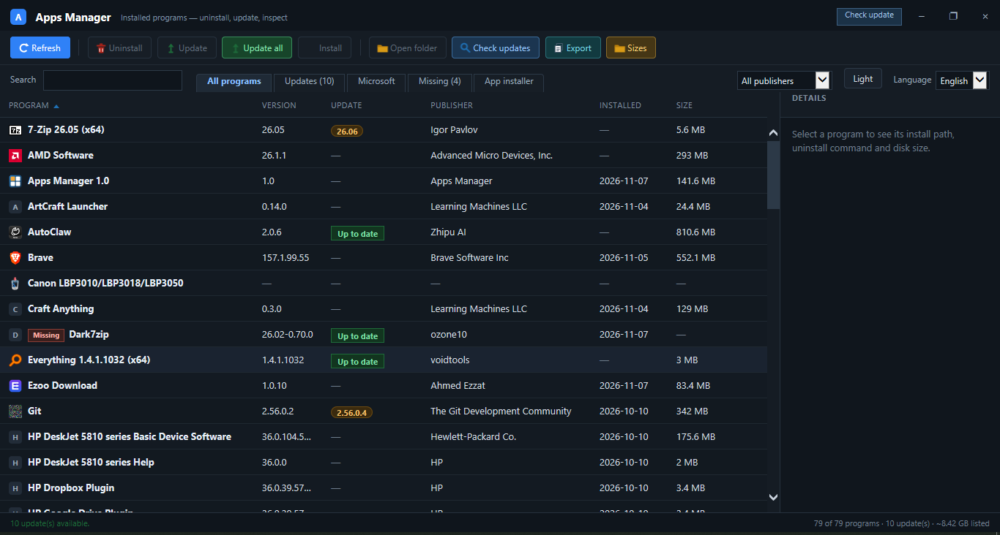

<div align="center">

# 🧩 Apps Manager

**اعرض وحدّث وأزل كل برامج ويندوز — من نافذة صغيرة واحدة.**

[](version.json)
[](#المتطلبات)
[](#المتطلبات)
[](#التحديثات)
[](#هيكل-المستودع)


[English](README.md) · [Français](README.fr.md) · **العربية**

[](https://github.com/youcef07dz/apps-manager-windows/raw/main/releases/AppsManager-Setup-1.1-Lite.exe)
[](https://github.com/youcef07dz/apps-manager-windows/raw/main/releases/AppsManager-Setup-1.1-Full.exe)



</div>

---

<div dir="rtl">

## الفهرس

- 🧭 [ما هو التطبيق](#ما-هو-التطبيق)
- ✨ [المزايا](#المزايا)
- ✅ [المتطلبات](#المتطلبات)
- 📥 [التثبيت](#التثبيت)
- 🖱️ [الاستخدام](#الاستخدام)
- 🔄 [التحديثات](#التحديثات)
- 🛠️ [البناء من المصدر](#البناء-من-المصدر)
- 🗂️ [هيكل المستودع](#هيكل-المستودع)

## ما هو التطبيق

Apps Manager تطبيق سطح مكتب أصلي لنظام ويندوز يعرض كل البرامج المثبّتة على الجهاز،
ويتيح إزالة تثبيتها أو تحديثها عبر **winget** أو تثبيت برامج جديدة من كتالوج winget.
ملف exe واحد (.NET) وصفحة HTML واحدة: يبدأ بسرعة، ويستهلك ذاكرة ومعالجًا قليلين،
و**بلا خدمة في الخلفية وبلا تتبّع**.

## المزايا

- 📋 **الجرد** — كل برنامج مع الإصدار والناشر وتاريخ التثبيت و**الحجم الحقيقي للمجلد**.
- 🧹 **التنظيف** — إزالة التثبيت، التشغيل، فتح مجلد التثبيت، نسخ المسار، فتح مفتاح
  التسجيل، من قائمة الصف.
- 🔄 **التحديثات** — تحديث برنامج واحد أو **تحديث الكل** عبر winget، مع **التحقق من
  التحديثات** مقابل الكتالوج. التحديثات المتجاهَلة تبقى متجاهَلة.
- 🛍️ **مثبّت التطبيقات** — البحث في winget وتثبيت الحزم دون مغادرة التطبيق.
- 🪟 تبويب **مايكروسوفت** (المتجر ومكوّنات النظام) وتبويب **مفقودة** للإدخالات التي
  لم يعد مجلدها موجودًا.
- 🚀 **عمود بدء التشغيل** — البرامج التي تعمل عند تسجيل الدخول.
- 📤 **التصدير** — حفظ القائمة بصيغة CSV متوافقة مع Excel.
- 🔎 **بحث** وتصفية حسب الناشر وأعمدة قابلة للفرز ومظهر فاتح/داكن.
- 🌍 الواجهة بـ **الإنجليزية والفرنسية والعربية**.
- ⬆️ **تحديث التطبيق نفسه** من شريط العنوان: تنزيل باستخدام aria2c ثم التحقق من
  SHA-256 ثم تشغيل المثبّت.
- 📦 **winget مضغوط** — يُشحن مضغوطًا ويُفك عند أول استخدام لتوفير مساحة القرص.

## المتطلبات

| | |
| --- | --- |
| **النظام** | ويندوز 10 إصدار 1809 (بناء 17763) أو أحدث |
| **التشغيل** | .NET Framework 4.8 (مثبّت مسبقًا على ويندوز 10/11 المحدّث) |
| **الإنترنت** | فقط للتحديثات والتثبيت والتحقق من الكتالوج |

## التثبيت

| النسخة | الحجم | winget | الأنسب لـ |
| --- | --- | --- | --- |
| 🟢 **Lite** | 2.4 ميجابايت | يُنزَّل عند أول حاجة | تنزيل صغير، جهاز متصل |
| 🔵 **Full** | 59 ميجابايت | مضغوط ويعمل دون إنترنت | بلا إنترنت، عدة أجهزة |

1. نزّل المثبّت أعلاه أو من مجلد [releases](releases).
2. شغّله واتبع المعالج. يثبّت في `C:\Program Files\Apps Manager` ويطلب صلاحيات
   المدير مرة واحدة.
3. افتح **Apps Manager** من قائمة ابدأ أو من اختصار سطح المكتب.

## الاستخدام

- تبويبات اليسار تنقلك بين **كل البرامج** و**التحديثات** و**مايكروسوفت** و**مفقودة**
  و**مثبّت التطبيقات**.
- انقر صفًا لعرض التفاصيل، أو انقر بالزر الأيمن لقائمة الإجراءات.
- **الأحجام** يقيس المجلد الحقيقي لكل برنامج. قد يستغرق دقيقة ويمكن إلغاؤه في أي وقت.
- **تحقق من التحديث** في شريط العنوان يحدّث Apps Manager نفسه.

## التحديثات

ملف `version.json` في هذا المستودع هو مصدر التحديث:

```json
{
  "version": "1.1",
  "url": "https://raw.githubusercontent.com/youcef07dz/apps-manager-windows/main/releases/AppsManager-Setup-1.1-Lite.exe",
  "sha256": "8555d6b4fac37b1375c214b750595a985777d7f6f2044ff8ba3be218881849cd",
  "size": 2425669
}
```

- تُقبل روابط **HTTPS** فقط.
- **SHA-256** من 64 حرفًا مطلوب.
- يُحذف الملف المنزَّل إذا لم تطابق البصمة.

يشير المصدر إلى نسخة Lite. لنشر إصدار جديد: ابنِه، ثم انسخ المثبّتين إلى
`releases/`، وحدّث `version.json`، ثم شغّل `push.cmd`.

## البناء من المصدر

يحتاج مترجم .NET Framework وبرنامج Inno Setup 5.6 في `C:\inno`.

```bat
src\build.cmd          :: نسخة 64 بت -> src\bin\AppsManager.exe
src\build.cmd x86      :: نسخة 32 بت -> src\bin\x86\AppsManager.exe
src\build-setup.cmd    :: المثبّتات -> src\dist\
push.cmd               :: الحفظ والرفع إلى GitHub
```

## هيكل المستودع

| المسار | المحتوى |
| --- | --- |
| `src/app.html` | الواجهة كاملة (HTML/CSS/JS متوافق مع IE8) |
| `src/*.cs` | منطق التطبيق: الفحص وwinget والتنزيل والتحديث |
| `src/lang/` | نصوص الإنجليزية والفرنسية والعربية |
| `src/tools/aria2c.exe` | أداة التنزيل المستخدمة لـ winget والتحديثات |
| `src/tools/winget.zip` | winget مضغوط يُفك عند أول استخدام |
| `version.json` | مصدر التحديث |
| `releases/` | المثبّتات المنشورة |
| `src/setup.iss` | سكربت Inno Setup |

</div>

---

<div align="center">

[English](README.md) · [Français](README.fr.md) · **العربية**

<sub>Apps Manager 1.1 — ويندوز 10/11 — بلا تتبّع وبلا خدمة في الخلفية.</sub>

</div>
