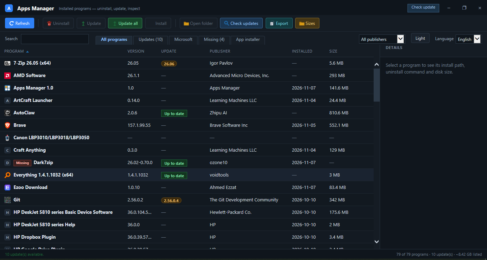

<div align="center">

# 🧩 Apps Manager

**Voir, mettre à jour et désinstaller tous les programmes de Windows — dans une seule petite fenêtre.**

[](version.json)
[](#configuration-requise)
[](#configuration-requise)
[](#mises-à-jour)
[](#organisation-du-dépôt)


[English](README.md) · **Français** · [العربية](README.ar.md)

[](https://github.com/youcef07dz/apps-manager-windows/raw/main/releases/AppsManager-Setup-1.1-Lite.exe)
[](https://github.com/youcef07dz/apps-manager-windows/raw/main/releases/AppsManager-Setup-1.1-Full.exe)



</div>

---

## Sommaire

- 🧭 [C'est quoi](#cest-quoi)
- ✨ [Fonctions](#fonctions)
- ✅ [Configuration requise](#configuration-requise)
- 📥 [Installation](#installation)
- 🖱️ [Utilisation](#utilisation)
- 🔄 [Mises à jour](#mises-à-jour)
- 🛠️ [Compiler](#compiler)
- 🗂️ [Organisation du dépôt](#organisation-du-dépôt)

## C'est quoi

Apps Manager est une application Windows native qui liste tout ce qui est installé sur
le PC et permet de désinstaller, mettre à jour avec **winget**, ou installer de nouveaux
programmes depuis le catalogue winget. Un seul exe .NET et une page HTML : démarrage
rapide, peu de RAM et de CPU, **aucun service en arrière-plan et aucune télémétrie**.

## Fonctions

- 📋 **Inventaire** — chaque programme avec version, éditeur, date d'installation et la
  **taille réelle du dossier** sur le disque.
- 🧹 **Nettoyage** — désinstaller, lancer, ouvrir le dossier, copier le chemin, ouvrir la
  clé de registre, depuis le menu de la ligne.
- 🔄 **Mises à jour** — mettre à jour un programme ou **Tout mettre à jour** avec winget,
  plus un passage **Vérifier les mises à jour** sur le catalogue. Les mises à jour
  ignorées restent ignorées.
- 🛍️ **App installer** — chercher et installer des paquets winget sans quitter
  l'application.
- 🪟 Onglets **Microsoft** (Store et composants système) et **Manquants** pour les
  entrées dont le dossier n'existe plus.
- 🚀 **Colonne démarrage** — quels programmes se lancent à l'ouverture de session.
- 📤 **Export** — enregistrer la liste en CSV, compatible Excel.
- 🔎 **Recherche**, filtre par éditeur, colonnes triables, thème clair/sombre.
- 🌍 Interface en **anglais, français et arabe**.
- ⬆️ **Mise à jour de l'application** depuis la barre de titre : téléchargement avec
  aria2c, vérification SHA-256, puis lancement du programme d'installation.
- 📦 **winget compressé** — livré compressé et décompressé à la première utilisation.

## Configuration requise

| | |
| --- | --- |
| **Système** | Windows 10 version 1809 (build 17763) ou plus |
| **Runtime** | .NET Framework 4.8 (déjà présent sur Windows 10/11 à jour) |
| **Internet** | uniquement pour les mises à jour, installations et vérifications |

## Installation

| Version | Taille | winget | Idéal pour |
| --- | --- | --- | --- |
| 🟢 **Lite** | 2,4 Mo | téléchargé au premier besoin | petit téléchargement, PC connecté |
| 🔵 **Full** | 59 Mo | compressé, fonctionne hors ligne | sans Internet, plusieurs PC |

1. Téléchargez le setup ci-dessus ou dans le dossier [releases](releases).
2. Lancez-le et suivez l'assistant. Il s'installe dans `C:\Program Files\Apps Manager`
   et demande les droits administrateur une fois.
3. Ouvrez **Apps Manager** depuis le menu Démarrer ou le raccourci du bureau.

## Utilisation

- Les onglets à gauche passent de **Tous les programmes** à **Mises à jour**,
  **Microsoft**, **Manquants** et **App installer**.
- Cliquez une ligne pour les détails ; clic droit pour le menu d'actions.
- **Tailles** mesure le dossier réel de chaque programme. Cela peut prendre une minute
  et reste annulable à tout moment.
- **Vérifier la mise à jour** dans la barre de titre met à jour Apps Manager.

## Mises à jour

`version.json` dans ce dépôt est le flux de mise à jour :

```json
{
  "version": "1.1",
  "url": "https://raw.githubusercontent.com/youcef07dz/apps-manager-windows/main/releases/AppsManager-Setup-1.1-Lite.exe",
  "sha256": "8555d6b4fac37b1375c214b750595a985777d7f6f2044ff8ba3be218881849cd",
  "size": 2425669
}
```

- Seuls les liens **HTTPS** sont acceptés.
- Un **SHA-256** de 64 caractères est obligatoire.
- Le fichier téléchargé est **supprimé** si l'empreinte ne correspond pas.

Le flux pointe vers le setup Lite. Pour publier une nouvelle version : compilez-la,
copiez les deux setups dans `releases/`, mettez à jour `version.json`, puis lancez
`push.cmd`.

## Compiler

Nécessite le compilateur .NET Framework et Inno Setup 5.6 dans `C:\inno`.

```bat
src\build.cmd          :: exe 64 bits -> src\bin\AppsManager.exe
src\build.cmd x86      :: exe 32 bits -> src\bin\x86\AppsManager.exe
src\build-setup.cmd    :: installateurs -> src\dist\
push.cmd               :: commit et envoi sur GitHub
```

## Organisation du dépôt

| Chemin | Contenu |
| --- | --- |
| `src/app.html` | toute l'interface (HTML/CSS/JS compatible IE8) |
| `src/*.cs` | logique : analyse, winget, téléchargements, mise à jour |
| `src/lang/` | chaînes en anglais, français et arabe |
| `src/tools/aria2c.exe` | téléchargeur utilisé pour winget et les mises à jour |
| `src/tools/winget.zip` | winget compressé, décompressé à la première utilisation |
| `version.json` | flux de mise à jour |
| `releases/` | setups publiés |
| `src/setup.iss` | script Inno Setup |

---

<div align="center">

[English](README.md) · **Français** · [العربية](README.ar.md)

<sub>Apps Manager 1.1 — Windows 10/11 — aucune télémétrie, aucun service en arrière-plan.</sub>

</div>
