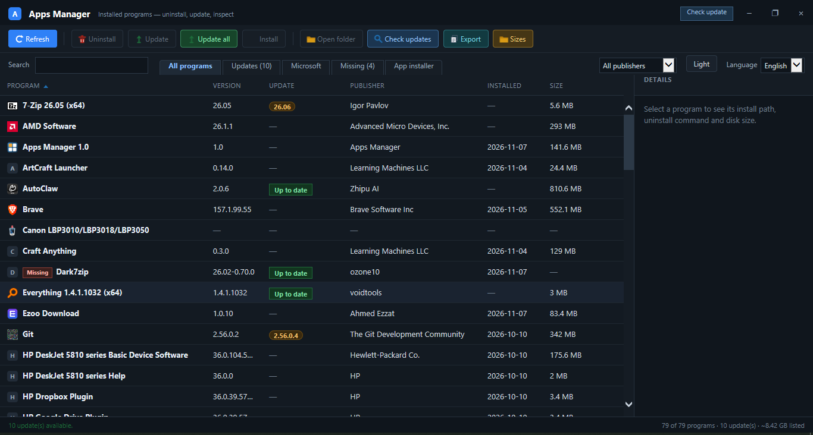

<div align="center">

# 🧩 Apps Manager

**See, update and remove every program on Windows — in one small window.**

[](version.json)
[](#requirements)
[](#requirements)
[](#how-updates-work)
[](#repository-layout)


**English** · [Français](README.fr.md) · [العربية](README.ar.md)

[](https://github.com/youcef07dz/apps-manager-windows/raw/main/releases/AppsManager-Setup-1.1-Lite.exe)
[](https://github.com/youcef07dz/apps-manager-windows/raw/main/releases/AppsManager-Setup-1.1-Full.exe)



</div>

---

## Contents

- 🧭 [What it is](#what-it-is)
- ✨ [Features](#features)
- ✅ [Requirements](#requirements)
- 📥 [Install](#install)
- 🖱️ [Use](#use)
- 🔄 [How updates work](#how-updates-work)
- 🛠️ [Build from source](#build-from-source)
- 🗂️ [Repository layout](#repository-layout)

## What it is

Apps Manager is a native Windows desktop app that lists everything installed on the PC
and lets you uninstall it, update it through **winget**, or install something new from
the winget catalog. One .NET exe plus one HTML page: it starts fast, stays light on RAM
and CPU, and has **no background service and no telemetry**.

## Features

- 📋 **Inventory** — every installed program with version, publisher, install date and
  the **real folder size** on disk.
- 🧹 **Cleanup** — uninstall, run, open the install folder, copy the path, open the
  registry key, all from the row menu.
- 🔄 **Updates** — update one app or **Update all** through winget, with a
  **Check updates** pass against the catalog. Ignored updates stay ignored.
- 🛍️ **App installer** — search winget and install packages without leaving the app.
- 🪟 **Microsoft** tab (Store and system components) and **Missing** tab for entries
  whose folder no longer exists.
- 🚀 **Startup column** — shows which programs launch when you sign in.
- 📤 **Export** — save the list to CSV, safe to open in Excel.
- 🔎 **Search**, publisher filter, sortable columns, light/dark theme.
- 🌍 **English, French and Arabic** interface.
- ⬆️ **Self-update** from the title bar: downloads the new setup with aria2c,
  verifies its SHA-256, then runs it.
- 📦 **Packed winget** — ships compressed and is unpacked on first use, saving disk.

## Requirements

| | |
| --- | --- |
| **OS** | Windows 10 version 1809 (build 17763) or later |
| **Runtime** | .NET Framework 4.8 (already present on updated Windows 10/11) |
| **Internet** | only for updates, installs and catalog checks |

## Install

| Build | Size | winget | Best for |
| --- | --- | --- | --- |
| 🟢 **Lite** | 2.4 MB | downloads on first use | small download, online PC |
| 🔵 **Full** | 59 MB | packed, works offline | no internet, many PCs |

1. Download the setup above or from the [releases](releases) folder.
2. Run it and follow the wizard. It installs to `C:\Program Files\Apps Manager` and
   asks for administrator rights once.
3. Start **Apps Manager** from the Start menu or the desktop shortcut.

## Use

- The tabs on the left switch between **All programs**, **Updates**, **Microsoft**,
  **Missing** and **App installer**.
- Click a row for details; right-click for the action menu.
- **Sizes** measures the real folder of every program. It can take a minute and can be
  cancelled at any time.
- **Check update** in the title bar updates Apps Manager itself.

## How updates work

`version.json` in this repo is the update feed:

```json
{
  "version": "1.1",
  "url": "https://raw.githubusercontent.com/youcef07dz/apps-manager-windows/main/releases/AppsManager-Setup-1.1-Lite.exe",
  "sha256": "8555d6b4fac37b1375c214b750595a985777d7f6f2044ff8ba3be218881849cd",
  "size": 2425669
}
```

- The app accepts only **HTTPS** links.
- A 64-character **SHA-256** is required.
- The downloaded file is **deleted** if the hash does not match.

The feed points at the Lite setup. To publish a new version: build it, copy both setups
into `releases/`, update `version.json`, then run `push.cmd`.

## Build from source

Needs the .NET Framework compiler and Inno Setup 5.6 in `C:\inno`.

```bat
src\build.cmd          :: 64-bit exe  -> src\bin\AppsManager.exe
src\build.cmd x86      :: 32-bit exe  -> src\bin\x86\AppsManager.exe
src\build-setup.cmd    :: installers  -> src\dist\
push.cmd               :: commit and push everything to GitHub
```

## Repository layout

| Path | What it is |
| --- | --- |
| `src/app.html` | the whole UI (IE8-safe HTML/CSS/JS) |
| `src/*.cs` | app logic: scanning, winget, downloads, self-update |
| `src/lang/` | English, French and Arabic strings |
| `src/tools/aria2c.exe` | downloader used for winget and updates |
| `src/tools/winget.zip` | packed winget, unpacked on first use |
| `version.json` | update feed |
| `releases/` | published setups |
| `src/setup.iss` | Inno Setup script |

---

<div align="center">

**English** · [Français](README.fr.md) · [العربية](README.ar.md)

<sub>Apps Manager 1.1 — Windows 10/11 — no telemetry, no background service.</sub>

</div>
